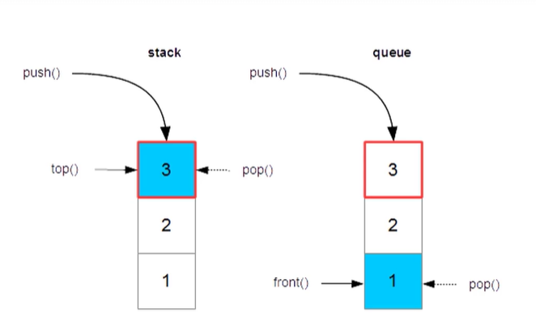

- map:vectorと同じく、配列の一種
- vectorはindexだが、mapはkeyでアクセス
```cpp
map<キーの型,値の型>;
score[names[0]] = 100;
```

- setは集合、重複して登録されても無視される
```cpp
set<型名> インスタンス名;
names.insert("Tom");
```

- stack:積み重ねるので、最後にいれたデータを先に出力される
last in first out

- que:行列なので、最初に登録したデータから順に検索していく
fisrt in first out

