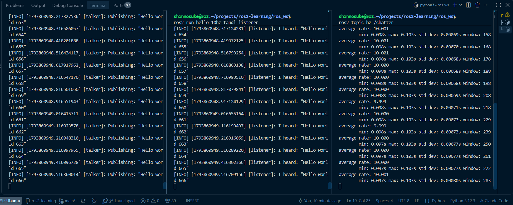

# ROS 2 Learning Log

Hands-on learning log toward **autonomous driving software integration** (ROS 2 / C++ / Autoware).
Background: 7 years of in-vehicle network (Automotive Ethernet / CAN) and gateway ECU development at an automotive OEM.

**Work in progress** — last updated 2026-11-05.

## Environment
- Windows 11 + WSL2 (Ubuntu 24.04)
- ROS 2 Jazzy
- Docker (`osrf/ros:jazzy-desktop`, with GUI display)
- g++ (C/C++ exercises)

## Repository Structure
| Directory | Content |
|---|---|
| `ros_ws/src/hello_10hz_tandl/` | rclpy talker / listener on `/chatter` (`std_msgs/String`) |
| `ros_ws/src/hello_1hz/` | 1 Hz timer-driven publisher |
| `ros_ws/src/my_learning_ros2/` | First node |
| `CPP/` | C / C++ fundamentals — course exercises plus my own notes (`*memo.md`) |
| `notes/` | Notes on ROS 2, Docker, Linux (LinuC), C |
| `screenshots/` | Execution results |

## Quick Start
```bash
cd ros_ws
colcon build --packages-select hello_10hz_tandl
source install/setup.bash

# terminal 1
ros2 run hello_10hz_tandl talker
# terminal 2
ros2 run hello_10hz_tandl listener
```



## C / C++ Topics Covered (`CPP/`)
- **C**: pointers, multi-file build with headers, file I/O
- **C++**: classes and encapsulation, constructors / destructors, static members, inheritance,
  virtual functions and polymorphism, interfaces (pure virtual), templates, STL (`vector`, `list`, `map`),
  operator overloading
- Representative examples:
  - Inheritance: `CPP/261101_section23/`
  - Virtual functions / interfaces: `CPP/261103_section30/`
  - Operator overloading: `CPP/261104_section31/`

## Progress
- [x] ROS 2 environment setup on WSL2 / Docker
- [x] rclpy publisher / subscriber with timer
- [x] C fundamentals
- [x] C++ fundamentals (classes, inheritance, polymorphism, templates, STL)
- [ ] Port talker / listener from rclpy to rclcpp (next)
- [ ] Service / action / launch file
- [ ] QoS settings and DDS behavior
- [ ] Dockerfile for a reproducible environment
- [ ] Autoware architecture study
